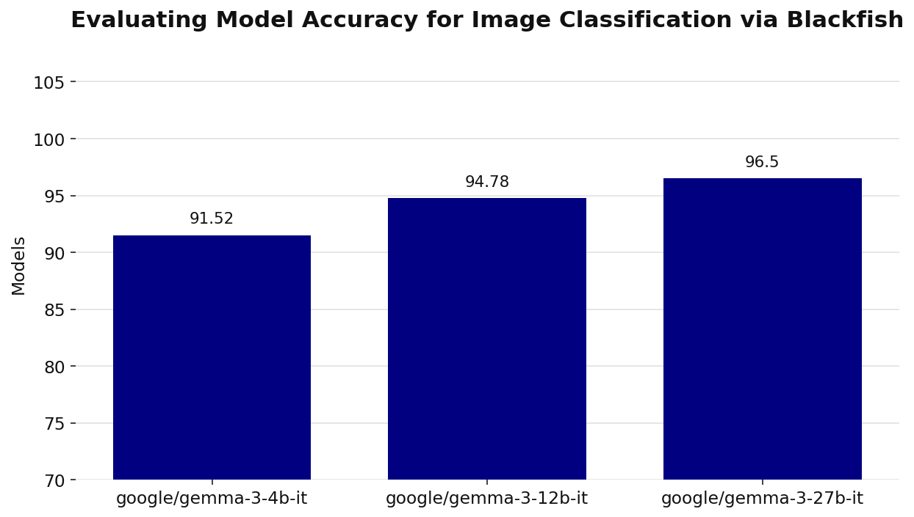

# Animal Classification

Example usage of the text generation service to classify images of animals from a [sample Kaggle dataset](https://www.kaggle.com/api/v1/datasets/download/iamsouravbanerjee/animal-image-dataset-90-different-animals).
It shows how to download the dataset, transfer it to a remote environment, and run inference using different language models.

To run this example:
1. All environment variables used by the scripts are defined in `env.sh`. Before running any of the examples, load these variables into your shell: `source env.sh`
2. Download the image samples locally and upload them to your remote cluster: `./download.sh`
3. Launch the service (assuming Blackfish is already running): `./launch.sh`
4. Run the script `python main.py`

**Note** - This example assumes that Blackfish is running on a remote cluster.
Also, there is an option to use a `data:` file format for the images. However, this
requires manually converting each image to PIL data. 

---

## Experimental Results

We conducted a series of experiments using multiple models to evaluate classification performance on the animal dataset. To evaluate the output, run the script `python evaluate.py`.

### Models 

* google/gemma-3-4b-it
* google/gemma-3-12b-it
* google/gemma-3-27b-it
* meta-llama/Llama-3.2-11B-Vision-Instruct*
* meta-llama/Llama-4-Scout-17B-16E-Instruct*
* meta-llama/Llama-3.2-90B-Vision-Instruct*

<small>*Evaluation in progress</small>

### Results Summary

| Model             | Accuracy (%) |
| ----------------- | ------------ | 
| google/gemma-3-4b-it       | 91.52         | 
| google/gemma-3-12b-it            | 94.78         | 
| google/gemma-3-27b-it             | 96.50        |

